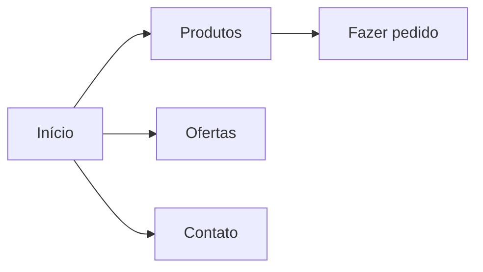

# Sistema Mercadinho Igor

> Projeto da Disciplina de Desenvolvimento de Software para Web 2026.2
> Universidade Federal do Ceará, Campus de Quixadá
> **Etapa 01:** Diagnóstico comunitário e proposta de uma solução Web

## Equipe

| Nome | Matrícula | GitHub |
|------|-----------|--------|
| Igor José Bastos Mota Filho | 557179 | @IgorF-prog |

**Professor(a):** Nator Júnior Carvalho da Costa

---

## 1. Público beneficiado

- **Nome do estabelecimento:** Mercadinho Igor
- **Tipo:** Pequeno Empreendedor
- **Localização:** Tauá-CE
- **Responsável(is):** Igor Mota
- **Atuação na comunidade:** Vende diversos tipos de produtos, atendendo principalmente aos vizinhos e familiares

## 2. Interação realizada

### 2.1 Escuta inicial

- **Data:** 26/10/2026
- **Formato:** presencial
- **Participantes:** Igor Filho

**Necessidades relatadas:**
- Algo para acompanhar melhor o controle da movimentação dos produtos
- Algo para fazer o caixa diário de forma mais rápida e precisa
- Uma identidade visual para o empreendimento

### 2.2 Apresentação da proposta e retorno

- **Data:** [dd/mm/aaaa]
- **O que foi apresentado:** [esboços, protótipo, lista de funcionalidades]
- **Retorno recebido:** [o que aprovaram, o que pediram para mudar]
- **Ajustes feitos no escopo:** [o que mudou depois do retorno]

### 2.3 Evidências

[Fotos, prints de conversa, anotações. Coloque os arquivos na pasta `docs/evidencias/` e liste aqui.]

- `docs/evidencias/conversa-01.png`
- `docs/evidencias/reuniao-01.jpg`

## 3. Problema identificado

- **Situação atual:** [como a demanda é atendida hoje: caderninho, WhatsApp, Instagram, de boca em boca...]
- **Público afetado:** [donos, funcionários, clientes]
- **Dificuldades:** [perda de pedidos, pouca divulgação, falta de organização, etc.]
- **Contribuição esperada da solução:** [o que vai melhorar com a aplicação Web]

## 4. Escopo

### 4.1 Objetivo

[Uma ou duas frases: o que a aplicação pretende resolver e para quem.]

### 4.2 Funcionalidades essenciais (primeira versão)

- [ ] [Funcionalidade 1, ex.: catálogo de produtos com preços]
- [ ] [Funcionalidade 2, ex.: pedido pelo WhatsApp]
- [ ] [Funcionalidade 3, ex.: ofertas da semana, horários e localização]

### 4.3 Limitações da primeira versão

- [O que **não** será feito agora, ex.: controle de estoque, pagamento online, PDV]
- Nesta etapa o protótipo é apenas HTML e CSS, sem interações em JavaScript.

## 5. Requisitos

### 5.1 Requisitos funcionais

| ID | Descrição |
|----|-----------|
| RF01 | O usuário deve poder [ação] |
| RF02 | O sistema deve exibir [conteúdo] |
| RF03 | ... |

### 5.2 Requisitos não funcionais

| ID | Descrição |
|----|-----------|
| RNF01 | Interface responsiva (celular, tablet e computador) |
| RNF02 | HTML semântico e cuidados básicos de acessibilidade (contraste, textos alternativos, navegação por teclado) |
| RNF03 | Identidade visual coerente com o estabelecimento |

## 6. Proposta de solução

### 6.1 Estrutura de páginas

| Página | Arquivo | Finalidade |
|--------|---------|-----------|
| Início | `index.html` | [apresentação e destaques] |
| Produtos | `produtos.html` | [catálogo] |
| Contato | `contato.html` | [horários, endereço, WhatsApp] |

### 6.2 Fluxo de navegação

[Insira um esboço ou diagrama. Exemplo com Mermaid, que o GitHub renderiza:]



### 6.3 Esboços (wireframes)

[Imagens em `docs/esboços/`, referenciadas aqui.]

### 6.4 Identidade visual

- **Cores:** [paleta e justificativa]
- **Tipografia:** [fontes]
- **Logotipo/imagens:** [origem e autorização de uso]

## 7. Protótipo

- **Como abrir:** baixe o repositório e abra `index.html` no navegador.
- **Demonstração online (opcional):** [link do GitHub Pages]

## 8. Estrutura do repositório

```
/
├── menu.html
├── pages/
├── css/
├── img/
├── docs/
│   ├── evidencias/
│   └── esboços/
└── README.md
```

## 9. Organização do trabalho

- **Branches:** `main` (versão estável), `develop` (integração) e branches de trabalho no formato `feature/nome-da-tarefa`.
- **Commits:** mensagens claras e no imperativo, ex.: `Adiciona página de produtos`.

| Integrante | Responsabilidades |
|------------|-------------------|
| [Nome] | [ex.: escuta com o beneficiado, README] |
| [Nome] | [ex.: página inicial e CSS base] |

## 10. Próximos passos (Etapa 02)

- Interações com JavaScript e manipulação do DOM
- Validação de formulários
- Consumo de APIs, quando pertinente
- Validação final com o público beneficiado
