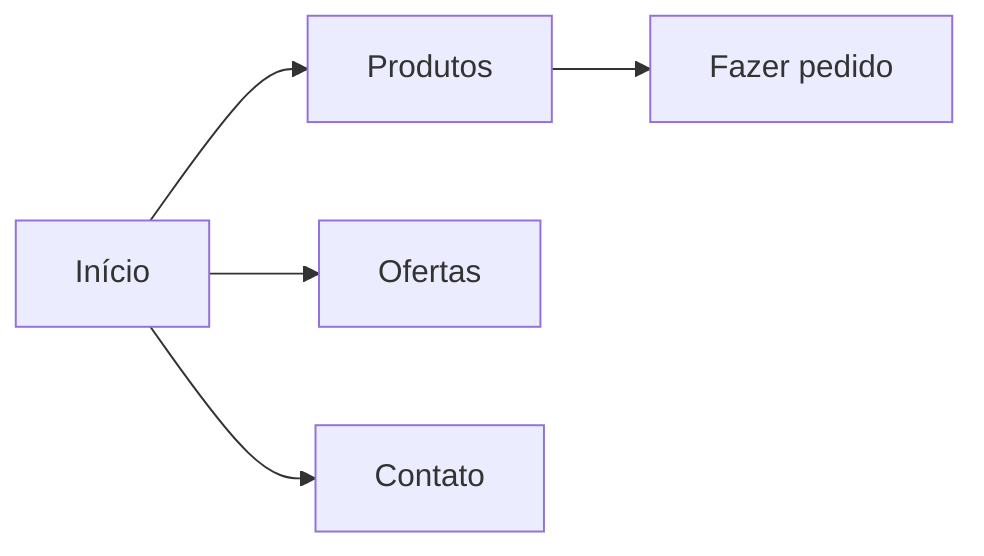

# Sistema Mercadinho Igor

> Projeto da Disciplina de Desenvolvimento de Software para Web 2026.2
> Universidade Federal do Ceará, Campus de Quixadá
> **Etapa 01:** Diagnóstico comunitário e proposta de uma solução Web

## Equipe

| Nome | Matrícula | GitHub |
|------|-----------|--------|
| Igor José Bastos Mota Filho | 557179 | @IgorF-prog |
| João Pinheiro Cavalcante | 606422 | @joaopinheiroc |

**Professor(a):** Nator Júnior Carvalho da Costa

---

## 1. Público beneficiado

- **Nome do estabelecimento:** Mercadinho Igor
- **Tipo:** Pequeno Empreendedor
- **Localização:** Tauá-CE
- **Responsável(is):** Igor Mota
- **Atuação na comunidade:** Vende diversos tipos de produtos, atendendo principalmente aos vizinhos e familiares

## 2. Interação realizada

### 2.1 Escuta inicial

- **Data:** 26/10/2026
- **Formato:** presencial
- **Participantes:** Igor Filho

**Necessidades relatadas:**
- Algo para acompanhar melhor o controle da movimentação dos produtos
- Algo para fazer o caixa diário de forma mais rápida e precisa
- Uma identidade visual para o empreendimento

### 2.2 Apresentação da proposta e retorno

- **Data:** [dd/mm/aaaa]
- **O que foi apresentado:** [esboços, protótipo, lista de funcionalidades]
- **Retorno recebido:** [o que aprovaram, o que pediram para mudar]
- **Ajustes feitos no escopo:** [o que mudou depois do retorno]

### 2.3 Evidências

[Fotos, prints de conversa, anotações. Coloque os arquivos na pasta `docs/evidencias/` e liste aqui.]

- `docs/evidencias/conversa-01.png`
- `docs/evidencias/reuniao-01.jpg`

## 3. Problema identificado

- **Situação atual:** Controle feito através de um caderno
- **Público afetado:** Donos e funcionários
- **Dificuldades:** Perda de pedidos, pouca divulgação, falta de organização, etc.
- **Contribuição esperada da solução:** Irá tornar o trabalho mais fácil e organizado

## 4. Escopo

### 4.1 Objetivo

Elevar a qualidade do trabalho de um pequeno empreendedor, fazendo com que ele cresça usando a tecnologia.

### 4.2 Funcionalidades essenciais (primeira versão)

- [x] Login do administrador (usuário e senha)
- [x] Cadastro, edição e listagem de produtos, com preço e quantidade em estoque
- [x] Entrada de produtos no estoque
- [x] Registro de vendas, com itens, total e forma de pagamento
- [x] Cadastro, edição e listagem de clientes
- [x] Consulta da conta de cada cliente, com saldo devedor e histórico detalhado de compras e pagamentos
- [x] Caixa diário, com resumo das vendas e fechamento

### 4.3 Limitações da primeira versão

- Nesta etapa o protótipo é apenas HTML e CSS, sem interações em JavaScript.

## 5. Requisitos

### 5.1 Requisitos funcionais

| ID | Descrição |
|----|-----------|
| RF01 | O administrador deve poder entrar no sistema com usuário e senha |
| RF02 | O sistema deve permitir cadastrar produtos (nome, categoria, preço, estoque mínimo), todos iniciando com estoque 0 |
| RF03 | O sistema deve permitir editar os dados de um produto |
| RF04 | O sistema deve listar os produtos com preço e quantidade em estoque, com busca por nome |
| RF05 | O sistema deve registrar a entrada de produtos no estoque, aumentando a quantidade e guardando o histórico |
| RF06 | O sistema deve registrar vendas com itens, quantidades, total e forma de pagamento (dinheiro, Pix ou cartão) |
| RF07 | O sistema deve dar baixa automática no estoque a cada venda registrada |
| RF08 | O sistema deve permitir cadastrar clientes (nome, telefone, bairro, CPF, permissão de compra no fiado e limite) |
| RF09 | O sistema deve permitir editar os dados de um cliente |
| RF10 | O sistema deve listar os clientes, com busca por nome |
| RF11 | O sistema deve permitir escolher um cliente e consultar sua conta, com saldo devedor, limite disponível e histórico detalhado de compras (produtos, quantidades e preços) e pagamentos |
| RF12 | O sistema deve registrar pagamentos da conta do cliente e atualizar o saldo devedor |
| RF13 | O sistema deve exibir o resumo do dia: número de vendas, total por forma de pagamento, produtos vendidos e entradas de estoque |
| RF14 | O sistema deve permitir o fechamento do caixa, comparando o dinheiro esperado (troco inicial mais vendas em dinheiro) com o dinheiro contado, e guardar o histórico dos fechamentos |

### 5.2 Requisitos não funcionais

| ID | Descrição |
|----|-----------|
| RNF01 | Interface responsiva (celular, tablet e computador) |
| RNF02 | HTML semântico e cuidados básicos de acessibilidade (contraste, textos alternativos, rótulos nos campos, navegação por teclado) |
| RNF03 | Identidade visual coerente com o estabelecimento, com uma única folha de estilo e paleta definida em variáveis CSS |
| RNF04 | Interface simples para quem não é da área de tecnologia, com poucos cliques por tarefa e textos claros |
| RNF05 | Arquivos e pastas organizados, com nomes claros |
| RNF06 | Funcionamento nos navegadores atuais, sem necessidade de instalação |
| RNF07 | Páginas leves, sem dependências externas |
| RNF08 | Código versionado no GitHub |
| RNF09 | Validação da senha no servidor e coleta mínima de dados pessoais dos clientes (previsto para a etapa 2) |
| RNF10 | Cálculo preciso de valores em dinheiro e saldos (previsto para a etapa 2) |

## 6. Proposta de solução

### 6.1 Estrutura de páginas

| Página | Arquivo | Finalidade |
|--------|---------|-----------|
| Início | `menu.html` | Login |
| admin | `admin.html` | Página principal do site |
| produtos | `cadastrar_produto.html` | Cadastrar produtos |
| produtos | `editar_produto.html` | Editar produtos |
| produtos | `listar_produtos.html` | Exibir lista de todos os produtos |
| clientes | `cadastrar_cliente.html` | Cadastrar clientes |
| clientes | `editar_cliente.html` | Editar clientes |
| clientes | `listar_clientes.html` | Exibir lista de todos os clientes |
| clientes | `contas_clientes.html` | Exibir contas de todos os clientes |
| operacoes | `caixa_diario.html` | Fazer o caixa de forma automática |
| operacoes | `entrada_estoque.html` | Registrar entrada de estoque |
| operacoes | `registrar_venda.html` | Registrar venda de produto |


### 6.2 Fluxo de navegação

[Insira um esboço ou diagrama. Exemplo com Mermaid, que o GitHub renderiza:]



### 6.3 Esboços (wireframes)

[Imagens em `docs/esboços/`, referenciadas aqui.]

### 6.4 Identidade visual

- **Cores:** azul (`blue`) no topo das páginas e nos botões, azul escuro (`darkblue`) em títulos e no efeito ao passar o mouse, fundo cinza claro (#F5F5F5), cartões brancos e texto em cinza escuro (#222222). Vermelho e verde aparecem apenas para indicar a situação da conta do cliente (Devendo e Em dia), sempre acompanhados de texto. O texto branco sobre o azul e o texto escuro sobre o fundo claro têm bom contraste, o que ajuda a leitura. As cores são definidas em variáveis CSS, o que permite trocar a paleta em um só lugar.
- **Tipografia:** Arial, com fonte sem serifa genérica como alternativa. É uma fonte do próprio sistema, que não precisa ser baixada da internet, então as páginas ficam leves e legíveis.
- **Logotipo/imagens:** logo do Mercadinho Igor (`logo.jpeg`), fornecida pelo proprietário [confirmar], com uso autorizado para este projeto. Não foram usadas outras imagens.

## 7. Protótipo

- **Como abrir:** baixe o repositório e abra `menu.html` no navegador.
- **Como navegar:** na tela de login, digite qualquer usuário e senha e clique em "Entrar". O login é apenas ilustrativo nesta etapa e não valida os dados. A partir do painel do administrador, é possível acessar as telas de clientes, produtos, vendas, estoque e caixa.
- **Demonstração online:** https://github.com/joaopinheiroc/mercadinho-igor

## 8. Estrutura do repositório

```
/
├── menu.html
├── sistema.css
├── logo.jpeg
├── admin/
|   ├── admin.html
├── produtos/
|   ├── cadastrar_produto.html
|   ├── editar_produto.html
|   ├── listar_produtos.html
├── clientes/
|   ├── cadastrar_cliente.html
|   ├── contas_clientes.html
|   ├── editar_cliente.html
|   ├── listar_clientes.html
├── operacoes/
|   ├── caixa_diario.html
|   ├── entrada_estoque.html
|   ├── registrar_venda.html
├── docs/
│   ├── evidencias/
│   └── esboços/
└── README.md
```

## 9. Organização do trabalho

- **Branches:** `main` (versão estável), `develop` (integração) e branches de trabalho no formato `feature/nome-da-tarefa`.
- **Commits:** mensagens claras e no imperativo, ex.: `Adiciona página de produtos`.

| Integrante | Responsabilidades |
|------------|-------------------|
| [Nome] | [ex.: escuta com o beneficiado, README] |
| [Nome] | [ex.: página inicial e CSS base] |

## 10. Próximos passos (Etapa 02)

- Interações com JavaScript e manipulação do DOM
- Validação de formulários
- Consumo de APIs, quando pertinente
- Validação final com o público beneficiado
